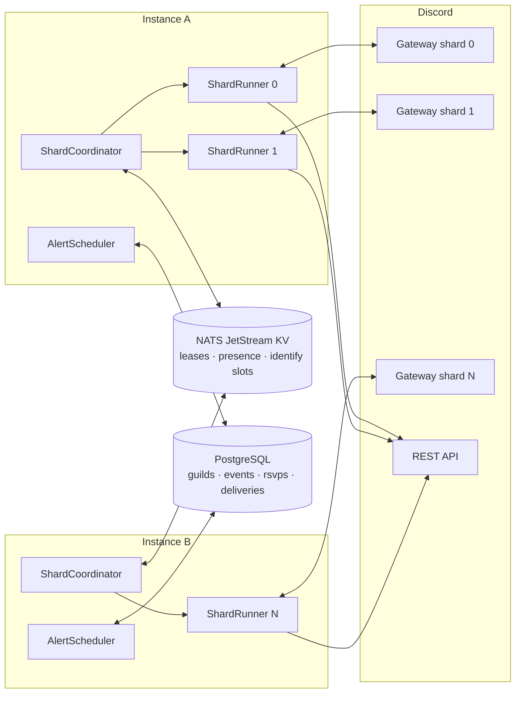

# Architecture

CalendarBot runs as any number of identical, stateless instances. They split
Discord's gateway shards between them through **NATS JetStream KV leases**, and
keep all durable state in **PostgreSQL**. Any instance can crash at any moment
without losing or duplicating an alert.



## Request flow

1. A shard's gateway session delivers `GUILD_SCHEDULED_EVENT_*` events and
   interactions for the guilds on that shard (`(guild_id >> 22) % shard_count`).
2. `EventSync` mirrors scheduled events into Postgres (Discord stays the source
   of truth; a full reconcile runs whenever a shard connects).
3. Every few seconds `AlertScheduler` asks Postgres which alerts are due *on the
   shards this instance owns*, claims each one, and posts it.
4. Button presses (RSVP, cancel) and `/alert` commands arrive on the same shard
   that owns the guild, so they are handled by the instance that owns it.
5. `CalendarExporter` regenerates the guild's `.ics` file after any change.

## Shard leases (NATS KV)

Bucket `<cluster>_shard_leases`, TTL = `LEASE_TTL_MS` (default 15 s):

| Operation | KV call | Guarantee |
| --- | --- | --- |
| Claim | `create("shard.N", id)` | Fails if the key exists, so only one owner |
| Renew (every TTL/3) | `update("shard.N", id, revision)` | Fails if anyone else wrote since, which detects a takeover |
| Release (shutdown/rebalance) | `delete("shard.N", previousSeq)` | Others can claim right away |
| Expire (crash) | bucket TTL | The shard is free again after ≤ TTL |

**Balancing.** Each instance heartbeats `{shards: [...]}` into
`<cluster>_instances` (same TTL). With *S* shards and *n* live instances, the
fair share is ⌊S/n⌋ or ⌈S/n⌉. An instance claims free shards up to ⌈S/n⌉. When
any instance holds fewer than ⌊S/n⌋, the most loaded instance (ties broken by
id, so exactly one per round) releases one shard per tick. The cluster
converges in a few ticks without flapping. An earlier `ceil`-only version left
a newly joined instance idle (4 shards / 3 instances → 2, 2, 0); the
integration test that caught it is in `test/cluster.test.ts`.

**Self-fencing.** If an instance cannot renew for 80 % of the TTL (e.g. it is
partitioned from NATS), it closes that shard's gateway session *before* the
lease can expire and be claimed elsewhere. This narrows the window in which two
instances serve the same shard. Postgres claims (below) make that window
harmless for alerts anyway.

**Shard count.** All instances must agree. The first instance stores its value
(`SHARD_COUNT`, or Discord's recommendation for `auto`) with `create` in
`<cluster>_config`. Later instances adopt the stored value.

**Identify rate limit.** Discord allows `max_concurrency` gateway IDENTIFYs per
5 s per bot, *across all processes*. discord.js only enforces this within one
process, so `NatsIdentifyThrottler` (plugged in via
`ws.buildIdentifyThrottler`) takes a slot with `create("bucket.<shard %
max_concurrency>")` in a bucket whose TTL is the 5 s window.

## Exactly-once alerts (PostgreSQL)

Alerts are not in-memory timers. The scheduler re-derives "what is due" from
the database each tick:

```sql
event.status = 'scheduled'
AND event.starts_at > now
AND event.starts_at - guild.alert_lead_minutes <= now
AND no live delivery row
AND (guild_id >> 22) % shard_count IN (<my shards>)
```

So restarts, shard moves and `/alert lead-time` changes need no rescheduling.
Before sending, an instance must win a claim on `alert_deliveries`, whose
primary key is `(event_id, starts_at)`:

```sql
INSERT INTO alert_deliveries (...) VALUES (..., 'pending', attempts = 1)
ON CONFLICT (event_id, starts_at) DO UPDATE SET status = 'pending', attempts = attempts + 1, ...
  WHERE (status = 'failed'  AND attempts < 3)            -- retry
     OR (status = 'pending' AND claimed_at < now - 2min) -- owner crashed mid-send
RETURNING *;
```

Concurrent claimers race on the primary key, and at most one gets a row back
(`test/db.test.ts` runs four at once). Rescheduling an event changes
`starts_at`, which correctly produces a new alert. The only duplicate scenario
is an instance that sends successfully and then dies within the 2-minute
stale window before recording `sent`.

## Data model

| Table | Purpose |
| --- | --- |
| `guilds` | Server name, alert lead time, optional alert channel override |
| `scheduled_events` | Mirror of Discord events; `sequence` bumps on visible changes (iCalendar `SEQUENCE`) |
| `rsvps` | Going / can't-make-it per user, from the alert buttons |
| `alert_deliveries` | Claim + outcome of each alert, and the posted message id (used to update it later) |

Migrations are generated by drizzle-kit (`drizzle/`) and applied on boot under
a Postgres advisory lock, so instances starting together don't race.

## Observability

- **Logs:** JSON (pino) with `instance` and `shard` fields.
- **HTTP:** `/healthz` (liveness), `/readyz` (NATS + Postgres + every leased
  shard connected), `/metrics` (Prometheus: shards owned, cluster size, lease
  transitions, alert outcomes, interactions, per-shard gateway ping).
- **NATS micro-service:** each instance registers as `<cluster>`, so the stock
  CLI works: `nats micro ls`, `nats req calendarbot.cluster ''` (shard map from
  any instance), `nats req calendarbot.instance.<id> ''`.

## Failure modes

| Failure | Effect |
| --- | --- |
| Instance crashes | Its shards are re-claimed within `LEASE_TTL_MS`. Pending alerts are re-derived from Postgres. Stale claims are taken over after 2 min |
| Graceful stop (SIGTERM) | Gateway sessions close, then leases are deleted, so handover is near-instant |
| NATS unavailable | Instances keep serving until renewals fail for 80 % of the TTL, then self-fence. They reclaim on reconnect |
| Postgres unavailable | Scheduler ticks fail and are retried; `/readyz` reports not ready |
| Discord send fails | Delivery is marked `failed` and retried up to 3 times while the event hasn't started |
| Alert channel deleted / no permission | Falls back to the system channel, then the first writable channel. `/alert settings` shows the problem |
